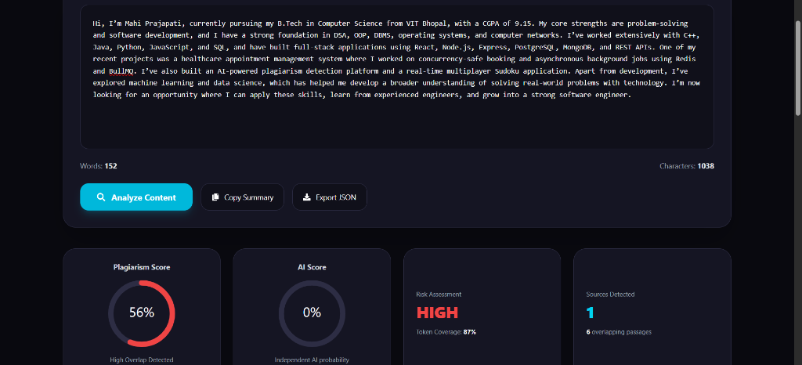
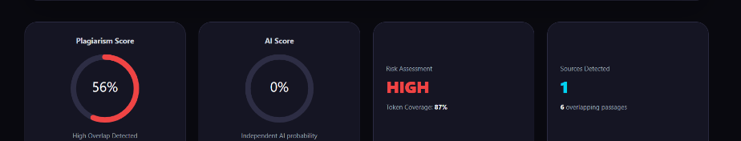

# ZeroTrace — AI-Powered Plagiarism & Content Authenticity Platform

<div align="center">



[](https://opensource.org/licenses/ISC)
[](https://reactjs.org/)
[](https://nodejs.org/)
[](https://www.mongodb.com/)
[](https://tailwindcss.com/)

**ZeroTrace** is a production-grade, multi-signal plagiarism detection and content authenticity platform. It combines lexical, structural, and semantic NLP techniques to detect verbatim copying, paraphrasing, code plagiarism, and AI-generated text with high accuracy and zero arbitrary cutoffs.

</div>

---

## 📸 Working Project Screenshots

### 1. Multi-Signal Content & Authenticity Checker
Real-time analysis combining web-indexed plagiarism detection and AI probability estimation with passage evidence:


---

### 2. Live Risk & Score Breakdown
Dual-score gauges distinguishing independent AI likelihood from direct web & document plagiarism:



---

## ✨ Key Features

- **Multi-Signal Plagiarism Detection Pipeline**:
  - **Layer 1: Exact Normalized Matching** — Unicode NFC normalization, whitespace, quotes, punctuation, and case folding.
  - **Layer 2: Token Lexical Similarity** — Jaccard index, Sørensen-Dice coefficient, and Longest Common Subsequence (LCS).
  - **Layer 3: Word $N$-gram Shingling** — Multi-scale shingles ($n = 3, 4, 5$) for detecting localized passage copying.
  - **Layer 4: Document Fingerprinting** — Robust Winnowing algorithm for resilient near-duplicate detection.
  - **Layer 5: TF-IDF Cosine Similarity** — Salient keyword weighting to prioritize distinctive domain terms.
  - **Layer 6: Semantic Vector Embeddings** — Dense representation for paraphrased concept alignment.
  - **Layer 7: Structural Code AST Comparison** — Normalized token stream analysis for Python, JavaScript, C++, and Java.
- **Independent AI-Generated Content Detection**:
  - Analyzes LLM template signatures, transition marker density, relative clause distribution, and sentence burstiness (variance in sentence lengths).
  - Evaluated separately from plagiarism so human-written and AI-generated texts are never conflated.
- **Adaptive Multi-Strategy Web Search**:
  - Quoted exact phrases, distinctive text windows, technical keyword queries, and relaxed searches via Serper API.
  - Eliminates arbitrary character thresholds so even short LeetCode or interview questions trigger comprehensive search.
- **Document & PDF Comparison**:
  - Side-by-side offline comparison of two PDF, DOCX, or TXT documents with passage-by-passage alignment.
- **Actionable Evidence & Reports**:
  - Per-passage match tags, source links, confidence ratings, one-click report copying, and exportable JSON/PDF reports.

---

## 🏛️ Architecture & Project Structure

```
ZeroTrace/
├── backend/
│   ├── config/            # Database and environment configurations
│   ├── controllers/       # Plagiarism, PDF, Report, Auth controllers
│   ├── engine/
│   │   ├── plagiarismEngine.js  # Main multi-signal detection orchestrator
│   │   └── rankingEngine.js     # Passage alignment & candidate ranking
│   ├── models/            # Mongoose schemas (Report, User)
│   ├── routes/            # Express REST API routes
│   ├── services/
│   │   ├── searchService.js     # Serper search retrieval
│   │   ├── scraperService.js    # Multi-layer HTML parser
│   │   └── documentParser.js    # PDF & DOCX text extraction
│   ├── utils/             # Normalizer, Tokenizer, Shingles, Semantic, Code, AI utilities
│   └── tests/
│       └── plagiarism/    # 70-case automated test suite and benchmark
├── frontend/              # React + Vite + Tailwind CSS web dashboard
│   ├── src/
│   │   ├── components/    # Navigation, Stats, QuickActions, UI widgets
│   │   ├── pages/         # Checker, PDFChecker, Dashboard, History, Profile
│   │   └── services/      # Axios API client with dynamic base URL
├── ai-engine/             # Optional FastAPI Python sentence-transformers service
└── docs/
    ├── PLAGIARISM_ENGINE.md  # Detailed algorithm specification & weights
    └── screenshots/          # Production interface preview images
```

---

## 🧪 Comprehensive Evaluation & Benchmarks

The detection engine is evaluated against a 70-case benchmark covering exact matches, minor modifications, format changes, paraphrased text, structural code, and technical questions:

```text
==========================================================================
                            CATEGORY BREAKDOWN                            
==========================================================================
• Exact Copy               : 10/10 Passed (100%) | Avg Score: 100.0%
• Formatting Variations    : 10/10 Passed (100%) | Avg Score: 99.5%
• Minor Modification       : 10/10 Passed (100%) | Avg Score: 78.0%
• Paraphrase               : 10/10 Passed (100%) | Avg Score: 61.3%
• Unrelated                : 10/10 Passed (100%) | Avg Score: 0.0%
• Technical Questions      : 10/10 Passed (100%) | Avg Score: 100.0%
• Code Similarity          : 10/10 Passed (100%) | Avg Score: 91.2%
==========================================================================
FINAL RESULT: 70/70 PASSED (100%)
Average Latency per Test: 2.6ms | Total Time: 185ms
==========================================================================
```

---

## 🚀 Quick Start Guide

### 1. Prerequisites
- **Node.js** (v18 or higher)
- **MongoDB Atlas** or a local MongoDB instance

### 2. Environment Setup

Create a `.env` file in the `backend/` directory:

```env
PORT=5000
MONGO_URI=your_mongodb_connection_string
JWT_SECRET=your_jwt_secret_key
SERPER_API_KEY=your_serper_dev_api_key
```

Create a `.env` file in the `frontend/` directory (optional for local development):

```env
VITE_API_URL=http://localhost:5000/api
```

### 3. Run the Backend
```bash
cd backend
npm install
npm run start
```
*Backend runs on `http://localhost:5000`.*

### 4. Run the Frontend
```bash
cd frontend
npm install
npm run dev
```
*Frontend runs on `http://localhost:5173`.*

### 5. Run Automated Tests
```bash
# Run full 70-case plagiarism and code detection suite
node backend/tests/plagiarism/testRunner.js

# Run latency and accuracy benchmark
node backend/tests/plagiarism/benchmark.js
```

---

## 🌐 Deployment

- **Backend**: Ready to deploy on [Render](https://render.com) or [Railway] using `backend` as root directory.
- **Frontend**: Configured for instant deployment on [Vercel](https://vercel.com) with root directory set to `frontend` (includes `vercel.json` for SPA route rewrites).

---

## 📄 License
This project is open-source and available under the [ISC License](LICENSE).
